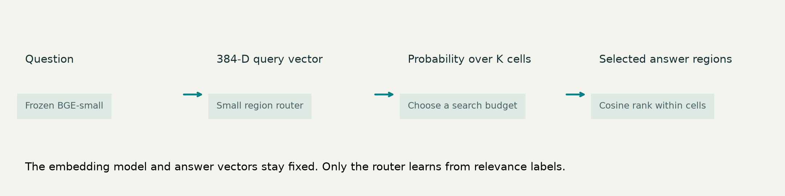
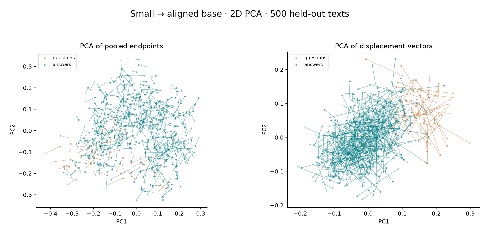
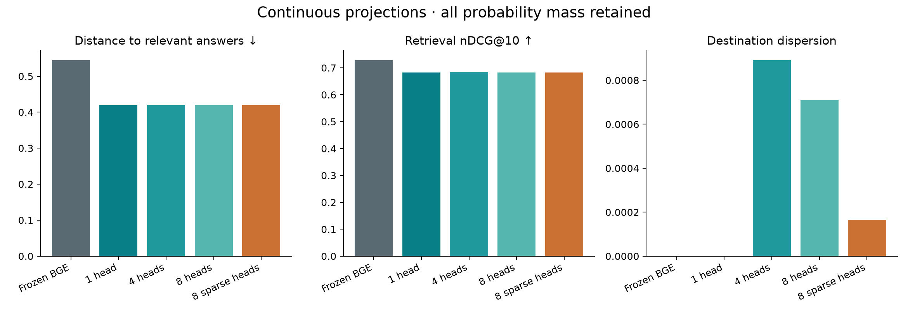
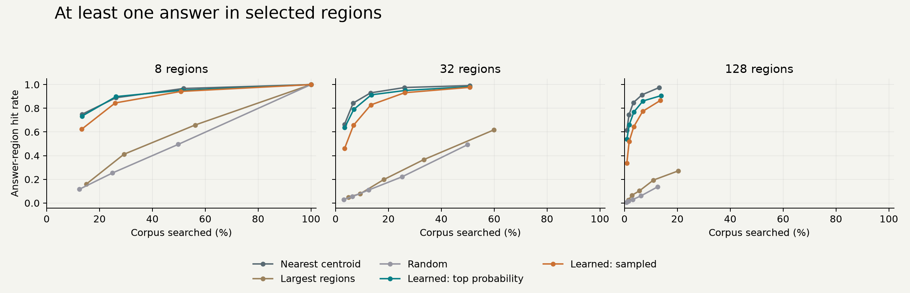
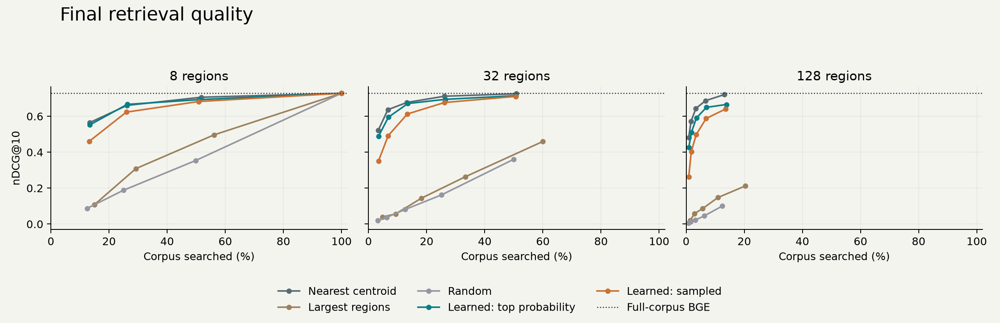
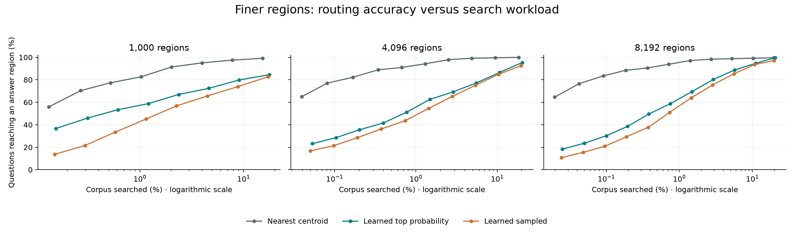

# Probabilistic Retrieval Fields

**Find the neighborhood. Then find the answer.**

Can a small neural router learn where relevant answers live without fine-tuning the embedding model?

This project explores retrieval adaptation over **frozen BGE-small embeddings**. The router predicts probabilities over regions of an existing answer corpus. Search visits a few regions, then ranks the answers inside them. Region granularity and search budget determine the accuracy–cost tradeoff.

[Interactive experiment explorer](https://ddrisco11.github.io/probabilistic-retrieval-fields/) · [Experimental protocol](docs/wikiqa_protocol.md) · [Literature review](docs/literature_review.md)



## Small-to-base vector field

[Rotate the 2D/3D field](https://ddrisco11.github.io/probabilistic-retrieval-fields/vector-field.html) · [Measurements](results/wikiqa-vector-field/summary.md) · [Alignment and PCA protocol](docs/vector_field_protocol.md)

Embed the same WikiQA texts with frozen BGE-small (384 dimensions) and BGE-base (768), align base into small's coordinates using training texts, and draw small-to-aligned-base arrows. Fit both endpoint PCA and displacement PCA on training data, then inspect held-out arrows. This compares representations of the same text; it is not a question-to-answer field.



**The field has local structure, but is not well summarized by a few principal directions.** Neighboring origins have more similar centered displacement directions than random pairs (mean cosine 0.134 versus 0.0003). A ten-neighbor estimate reduces held-out displacement MSE by 10.2% versus a global-mean movement. The effect persists within questions (8.3%) and answer sentences (9.6%), so it is not solely a question/answer distinction. This supports investigating a local adapter, without yet demonstrating retrieval gains from predicted movements.

The plots show partial question/answer separation and varied arrow directions. There is no dominant global translation: mean drift accounts for only 0.083% of held-out arrow energy. Even displacement-focused PCA retains only 1.4% of held-out centered movement energy in 2D and 2.1% in 3D. Spatial endpoint PCA retains 0.7% and 1.1% of arrow energy, respectively. Apparent low-dimensional patterns therefore need the full-space checks above; the figures do not establish semantic clusters, vortices, or a simple global flow.

The 768→384 alignment retains 91.5% of held-out centered base embedding energy, which is not a measure of retained semantic information. Native base retrieval scores 0.762 nDCG@10 versus small's 0.728; the paired difference is +0.034, with 95% interval [+0.014, +0.055]. Aligned base scores 0.767, but base embeddings are still required for those endpoints. This does not establish an adapter that replaces base inference.

All 26,196 answers and 3,047 questions were embedded. Alignment/PCA used 19,810 training texts; field statistics use 5,767 test texts after removing answers shared across splits. Base encoding took about 340 seconds and analysis about 6 seconds, using cached small embeddings. The viewer displays a seeded 500-point subset with actual projected arrow lengths; full measurements are saved separately.

## Continuous weighted projections

The latest experiment directly predicts continuous destinations from each frozen query vector, with a learned weight for each destination. It uses **every weight**: the reward is the sum of each weight times negative squared distance to the relevant answer. There is no 95% cutoff. An optional sparse gate can learn exact zero weights, selecting an active subset of up to eight predictions.

[Interactive projection weights](https://ddrisco11.github.io/probabilistic-retrieval-fields/projections.html) · [Full protocol and mathematical limits](docs/projections_protocol.md) · [Measured results](results/wikiqa-projections/summary.md)

| Model | Expected squared distance ↓ | nDCG@10 ↑ | Mean active predictions |
|---|---:|---:|---:|
| Frozen BGE | 0.5442 | 0.7281 | 1.00 |
| One learned projection | 0.4198 | 0.6820 | 1.00 |
| Four weighted projections | 0.4198 | 0.6852 | 4.00 |
| Eight weighted projections | 0.4199 | 0.6833 | 8.00 |
| Eight projections with sparse weights | 0.4195 | 0.6832 | 4.03 |

Three training seeds took 48.5 seconds total with cached embeddings. Training improved the intended distance reward, but worsened retrieval ranking. Multiple destinations became nearly identical. The sparse model's nDCG difference from the single projection was +0.0013, with query-paired 95% bootstrap interval [−0.0010, +0.0038], providing no clear multi-projection advantage here.



For squared distance, the weighted score ranks answers exactly like a single weighted-average vector. All probability mass is retained in this reduction. This limits the objective's ability to exploit distinct modes; a nonlinear distance reward would be a separate experiment. The region experiments below remain available as an earlier formulation.

## Why this is useful to investigate

Fine-tuning an encoder can align queries with domain-specific documents, but it adds training cost and can require re-embedding the corpus. A small router offers a different adaptation point: keep the encoder and document vectors fixed, and learn which parts of that space deserve attention.

A probability distribution can put mass on several answer regions. It does not require random inference: searching the most likely regions may work better than sampling them. Both are tested here.

This is exploratory research. There is no assumed performance win, novelty claim, or measured claim of lower cost than full encoder fine-tuning.

## The experiment

- **Encoder:** `BAAI/bge-small-en-v1.5`, frozen, 384 dimensions.
- **Benchmark:** [Microsoft WikiQA](https://huggingface.co/datasets/microsoft/wiki_qa), with official question splits.
- **Corpus:** 26,196 unique answer sentences, including negative candidates.
- **Answerable questions:** 873 train / 126 validation / 243 test.
- **Regions:** 8, 32, 128, 1,000, 4,096, or 8,192 document-only spherical k-means cells.
- **Router:** a 64-unit MLP residual over centroid similarities, trained on relevant-answer region distributions.
- **Controls:** nearest centroid, largest regions, uniform random routing, and full-corpus dense retrieval.
- **Budgets:** powers of two up to 1,024 regions at the finest resolution; three training seeds.

The searchable corpus combines answer sentences across splits. Questions without a labeled positive are excluded and counted. This is an adapted **global retrieval** task, not the candidate-restricted WikiQA leaderboard. Corpus construction sees answer text; training and checkpoint selection never use test relevance labels.

## Results

**High regional coverage is possible here, but the learned router does not beat the geometric control.** With 32 regions and four probes:

| Method | Questions reaching an answer region | Corpus searched | nDCG@10 |
|---|---:|---:|---:|
| Nearest-centroid routing | 93.0% | 13.2% | 0.677 |
| Learned top-probability routing | 91.4% | 13.5% | 0.671 |
| Learned sampled routing | 82.9% | 13.4% | 0.612 |
| Full-corpus frozen BGE | 100% by construction | 100% | 0.728 |

The learned-minus-centroid region-hit difference is −1.65 percentage points, with a paired 95% bootstrap interval of [−4.66, +1.10] points. This does not establish a benefit from learning. At finer 128-region granularity, the learned router also trails the geometric control. These are useful negative results: BGE already provides a strong routing geometry, and this small supervised adapter has not improved it.





The complete measurements, per-query rankings, paired confidence intervals, training curves, exact revisions, and configurations are in [results/wikiqa-regions](results/wikiqa-regions). The [interactive explorer](https://ddrisco11.github.io/probabilistic-retrieval-fields/) changes partition granularity, number of regions searched, and the quality metric.

High region accuracy alone is insufficient. Searching all regions yields perfect region coverage by construction. The useful comparison is quality **at a given fraction of the corpus searched**, alongside final answer-ranking quality.

## Finer partitions

The additional 1,000-, 4,096-, and 8,192-region runs took approximately **304 seconds total** on the local Mac, using cached BGE embeddings. This includes partitioning, training three seeds per resolution, and evaluation; it excludes the earlier embedding download/encoding. At 8,192 regions, the median region contains just two answer sentences.

| Regions | Probes | Centroid region hit | Learned region hit | Corpus searched, centroid / learned |
|---:|---:|---:|---:|---:|
| 1,000 | 16 | 91.4% | 66.9% | 2.02% / 2.37% |
| 4,096 | 64 | 97.9% | 69.3% | 2.51% / 2.87% |
| 8,192 | 128 | 98.4% | 80.2% | 2.72% / 2.91% |

These are similar-workload operating points, not exact budget matches. Finer granularity does not give this learned classifier an advantage. At 8,192 regions, only 869 regions contain a positive training answer; 84.6% of held-out positive answer occurrences belong to regions with no positive training example. Sparse supervision is a plausible limitation, not an isolated causal finding. At 1,024 probes both learned and centroid routing reach 99.6% region hit, while searching approximately 20% of the corpus.



The adapter predicts a categorical distribution over fixed answer regions from the query embedding. It can favor remote regions. Its loss rewards the labeled answer regions, without explicit neighboring-region credit. It does not generate continuous displacement vectors, and final answer ranking still uses the original query cosine. These results therefore test the region-classification implementation, not every possible probabilistic movement adapter.

See the measured [1,000-region](results/wikiqa-1000-regions/summary.md), [4,096-region](results/wikiqa-4096-regions/summary.md), and [8,192-region](results/wikiqa-8192-regions/summary.md) runs. Each directory includes configurations, seed-level results, and per-query measurements. Reproduce each with the matching `configs/wikiqa-N-regions.json` passed to `python -m prf.regions`. The expanded sweep is exploratory: test results from earlier resolutions were already inspected, so a fresh benchmark is needed for confirmatory comparisons.

## Reproduce

Python 3.12 is the tested runtime. A CPU is sufficient for these small experiments.

```bash
python -m venv .venv
source .venv/bin/activate
pip install -e '.[benchmark,dev]'
pytest -q

# Download the dataset/model and cache normalized embeddings.
HF_HOME="$PWD/cache/huggingface" python -m prf.wikiqa \
  --dataset-revision 3f104672b5de699878fe7907afc486f0de325eb5 \
  --model-revision 5c38ec7c405ec4b44b94cc5a9bb96e735b38267a \
  --output cache/wikiqa-bge.pt

# Train routers and evaluate fixed held-out questions.
python -m prf.regions --data cache/wikiqa-bge.pt \
  --config configs/wikiqa-regions.json --output results/my-wikiqa-run
```

Open the generated `explorer.html` in a browser. Output directories must be new to prevent overwriting experiments. `requirements-lock.txt` records exact versions used locally; the package metadata provides broader cross-platform requirements. Downloaded data, models, caches, and checkpoints are intentionally excluded from Git.

## Continuous stochastic retrieval controls

The original continuous formulation learns locations in the fixed embedding space. It is implemented separately so that a Gaussian sampler is not confused with a discrete region classifier.

| Model | Retrieval representation |
|---|---|
| Frozen dense | Original query vector |
| Deterministic adapter | One residual MLP vector |
| Deterministic multi-vector | Up to four learned vectors |
| Random perturbation | Query-centered fixed Gaussian noise |
| Conditional Gaussian | Learned mean and diagonal scale |
| Gaussian mixture | Learned component probabilities, means, and diagonal scales |

Stochastic policies support a differentiable relevance surrogate, REINFORCE with a leave-one-out baseline, and hybrid training. Synthetic experiments include single/multiple relevant clusters, overlap, ambiguity and imbalanced relevance, with and without regularization.

```bash
python -m prf.cli run --config configs/synthetic.json --output results/my-synthetic-run
python -m prf.cli run --config configs/synthetic-no-kl.json --output results/my-no-kl-run
```

See [synthetic results](results/synthetic/summary.md), [regularization ablation](results/synthetic-no-kl/summary.md), and [continuous-model protocol](docs/benchmark_protocol.md). A BEIR loader and encoding command support additional corpora; SciFact is an optional next benchmark rather than the main result here.

## What this does—and does not—show

- Region probabilities describe the location of a randomly drawn labeled relevant answer; they are not independent probabilities that each region contains any answer.
- The router is specific to the corpus partition. Universal pretrained-router transfer is not established.
- Probability quality, search reduction, and final ranking quality are different measurements.
- Three optimization seeds share one partition seed. More datasets and partition seeds are needed for general conclusions.
- Exact within-region search isolates routing behavior. It is not an industrial ANN scalability result.
- No full-encoder or LoRA training run is included, so cost savings against those methods are not measured.
- Related work includes Search-Adaptor, Neural LSH, learned cluster routing, probabilistic embeddings, and RELER. See the [primary-source review](docs/literature_review.md).

## Repository map

`prf/wikiqa.py` prepares the frozen benchmark; `prf/regions.py` implements partitioning, router training and evaluation; `prf/models.py` and `prf/experiment.py` implement continuous policies; `tests/` checks metrics, gradients, splits and routing; `docs/` contains protocols and the static interactive explorer.

Code: MIT. External data/model licenses remain with their respective sources. The repository distributes code and aggregate/per-query numeric results, not the raw WikiQA corpus or pretrained weights.

A ready-to-enable [GitHub Actions test configuration](docs/examples/github-actions-tests.yml) is included as an example. To enable it, place it in `.github/workflows/tests.yml` using credentials with workflow permissions. Local test results are independent of CI enablement.
